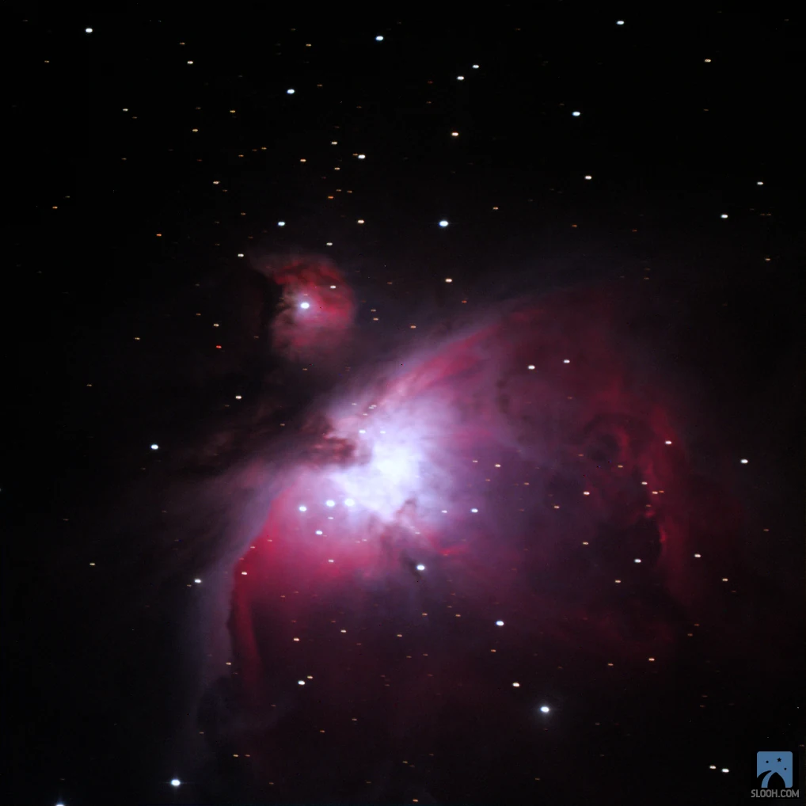
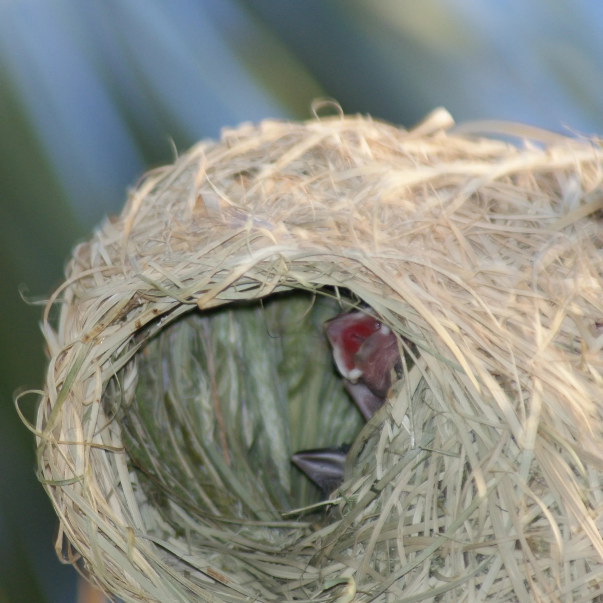
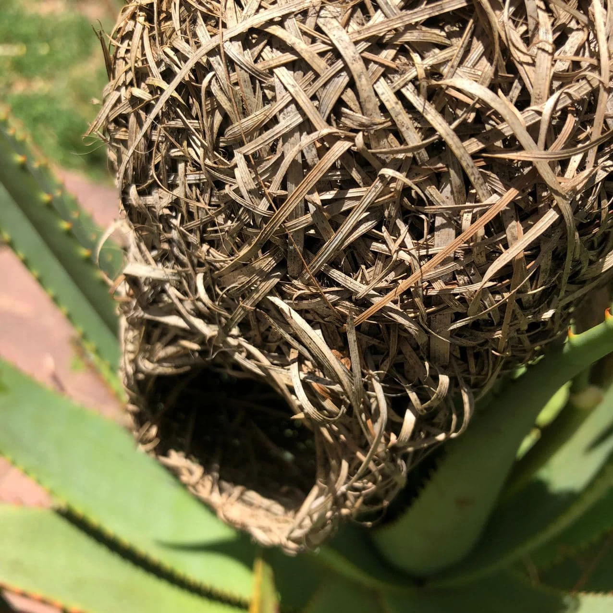
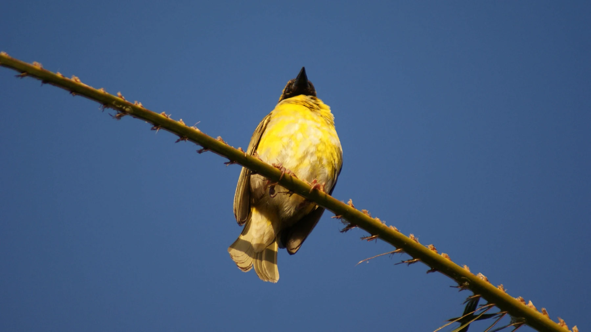
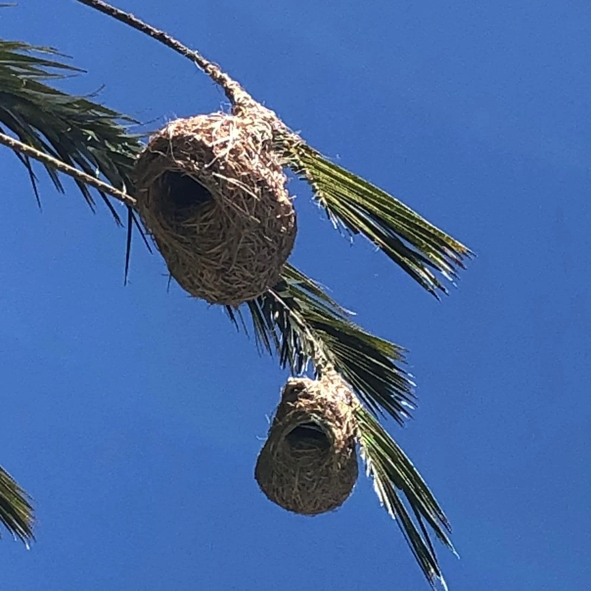

I observe two nurseries hanging in the sky outside my window. Vastly different, yet shrouded in equal mystery as both still hold on to secrets, rewarding the brave and patient, those who unravel the cosmos in systematic and careful observations from one data point the next. My own observations are sporadic and impulsive, I look up and outside -- the first nursery sways about 10 feet away from me, a bulbous bunch of nests, expertly woven in the wind, home to Cape Weavers who we’ve shared our garden with for almost 5 years now. The green braids of grass, fading to brown within days in the ultraviolet rays of the sun.

Orion Nebula

Young Baby Birds

Weaver Nests

The second nursery, hangs outside my window, about 1400 light years away. It is the Orion Nebula, and this candy-coloured cocoon announces the birthplace of about a thousand stars. My human eye has collaborated with light and atoms to weave shades of red and pink with some hues of purple and blue shaping this marvellous emission nebula.

Allow me to break it down for you, the birth of baby birds, the fading of grass and the chemical process of ionization that colours and shapes our observations of places and spaces of births.

The Orion Nebula is classified as an emission nebula. These are huge clouds of ionized gas that emit their own light, in the same way that a neon light glows. This happens as young hot stars emit high energy ultraviolet photons (light). As the young stars shine so bright, their UV photons mingle with hydrogen atoms that are found in abundance. This connection and reaction, causes the hydrogen atoms to undergo changes in their state, they move from a neutral state, to an excited state, back to a lower energy state again all the while emitting tiny packets of light at a wavelength in the red end of the spectrum. This emission, weaves strips of candy coloured red and pink hues like giant cocoons where young stars live. How beautiful is that?

Our Cape Weaver

Closer to home again, the weavers’ nests turn brown against the blue sky, our sun gives life and as evening gets closer and the sun begins to set, I hear and see pleas of hungry baby weavers eager to get fed. Later still, the dark further saturates and I look up to where Orion’s Belt and Sword hangs, I draw a line to where it ends and find the Orion Nebula (M42), eagerly emitting and splendid.

All things considered, life is an immense chemical reaction, from the faded brown nest swaying against a sky, to the red and pink hues of nebulae. To fully appreciate it we too, need to stay open to all possibilities, to mingle freely, to interact and allow chemical bonds to form and break. Life and death lay equal claim to our minds and hearts. There is so much life to be found inside what appears from the outside to have faded, really, we need to consider the beauty in the unlikeliest places. Prepare to be surprised. When we, like atoms are moved and energised we begin to transfer energy to matter and become fully alive. Always consider the beauty. Always.

To explore the skies, join us on Slooh, where amateur and professional astronomers join in learning, exploring and teaching.

On [Slooh](http://www.slooh.com "Slooh"), you can join quests and learn more about Emission Nebulae and other types of Nebulae, such as Reflection, Dark Nebulae and Planetary Nebulae.
