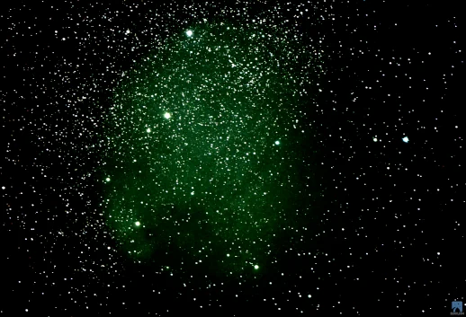

It's with awe and somehow a little sadness and a smile, that I share how, in 2020 science settled the controversy surrounding the distance to the North American Nebula. Amid uncertainty surrounding almost every aspect of our lives, with astonishing precision, the Gaia astrometry satellite shows the North America and Pelican nebulae lie 2,590 light years away.

Meanwhile, we crawl through shadows and claw our way through hardship and anxiety. We crave for light and truth and togetherness, while drifting further apart.

How far to love and kindness and peace?

How can we be certain?

Trust the instrument of your heart.

Love is precise, it crosses vast distances, it defines us when chaos ensues. It is the only measure.

In this picture: NGC7000 North America Nebula
