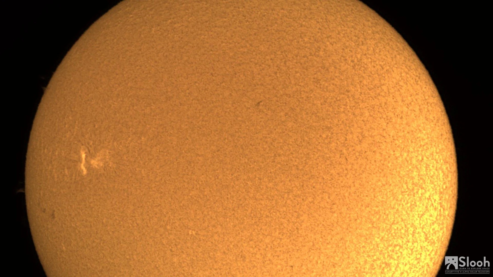
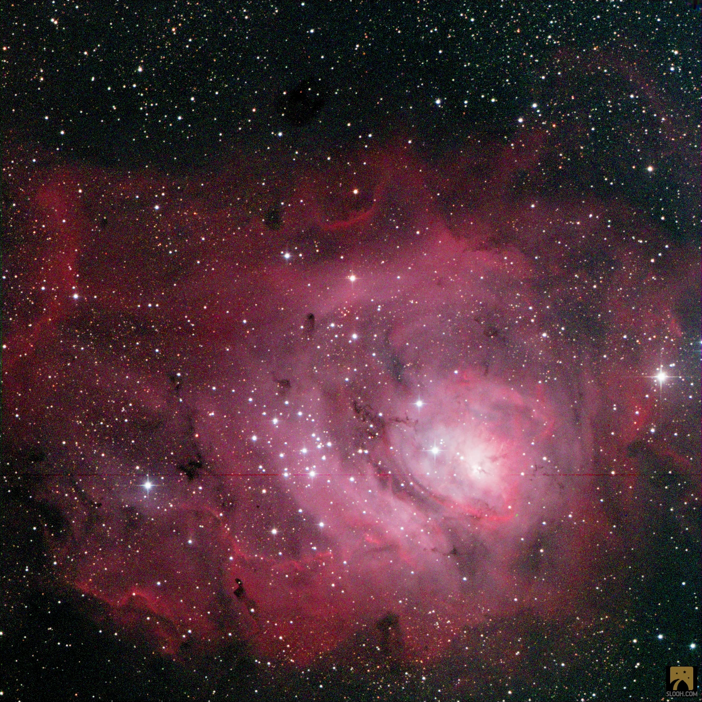
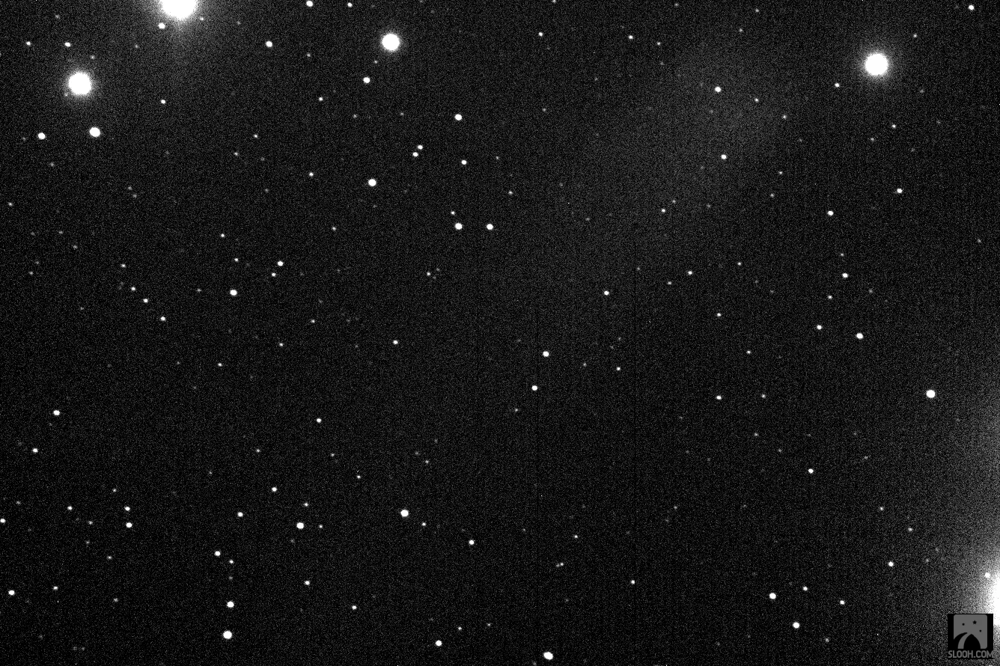

My first ever image captured on SLOOH was of Caldwell 41 (Mel 25).

The Sun a ripe orange

The Candyfloss Lagoon

Caldwell 41 (Mel 25)

It was completely unintentional. I was still trying to figure out how it all worked. I clicked a few buttons, then embarked on my first quest and purposefully took a photo of our magnificent Sun. My mind melt a little like the wings of Icarus. I flew too close to something unimaginably immense. This was different from looking at a PBS documentary or a BBC show. I took this photo, I observed.

As I scrolled through my photo roll I realised that I had also snapped Caldwell 41. My first image on SLOOH ever. I later sent the photo of this massive orange fruit hanging in the sky as a birthday image to a very dear friend in the US. In retrospect Caldwell 41, deserves some special mention too, how a fumbling, fool with an iPhone manage to capture albeit the nearest open cluster, well studied but still, 153 light-years away.
A spherical group of hundreds of stars in the constellation of Taurus.

I am young and foolish, forever trying to escape the gravity of everything serious. Play and learn, play and learn.
