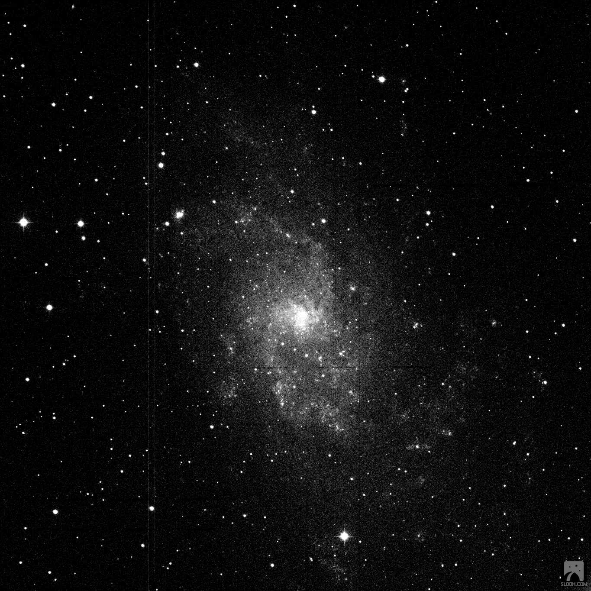
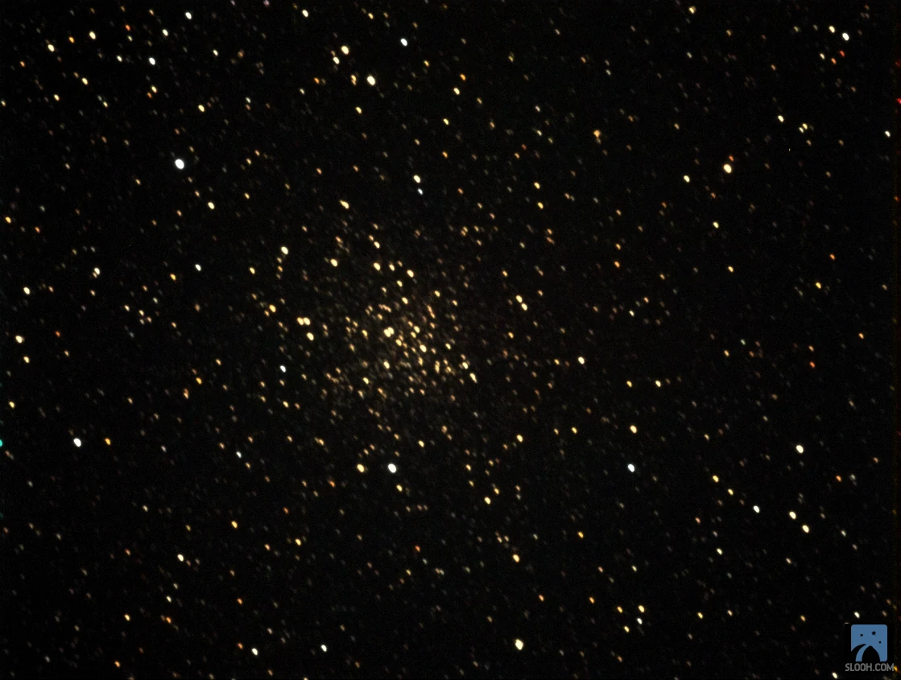
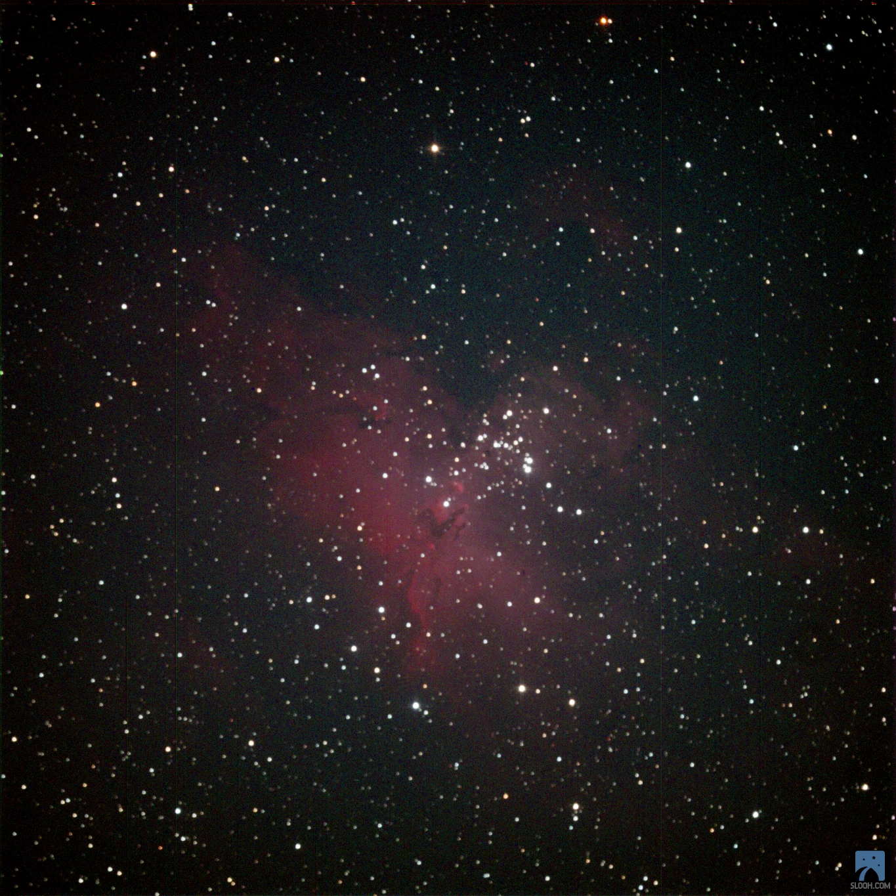

I started running about 10 years ago and have completed a couple of half-marathons, but sitting on my behind for a living and crafting software has not served me well to complete a full marathon, yet. There is a different marathon that I will soon be taking part in however, which is the Messier Marathon. I will be rewarded for sitting on my butt while I marvel at the wonders of a catalog compiled by comet hunter, Charles Messier and first published in 1774.

The Messier objects are not evenly distributed throughout the sky. But astronomer Don Machholz worked out the observing order, or search sequence, based upon the commonly used **_Atlas of the Heavens_**, star atlas. I am not quite ready and it won't be possible until March / April 2021 to take part in the Messier Marathon and observe all 110 wonders in a single sitting.

In the meanwhile, do enjoy the images of nebulae I capture on SLOOH.

PS: Did I mention Charles Messier became famous for the very thing he tried to avoid? In an effort to find comets he catalogued the foggy bits and bobs that we now know and love as the wonders in the Messier Catalog.

