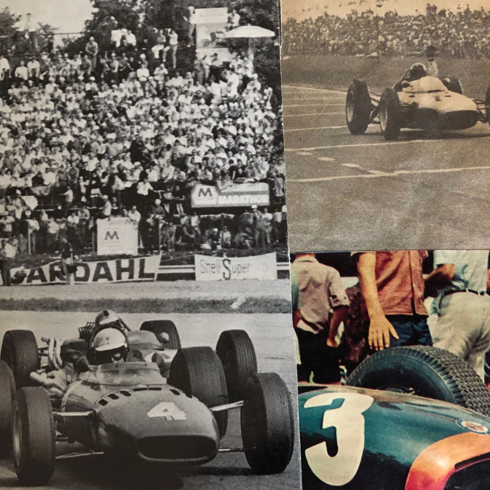
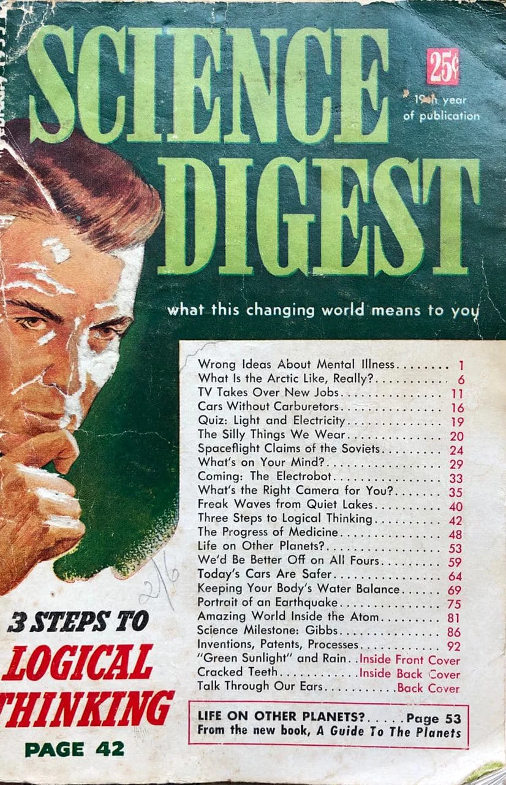
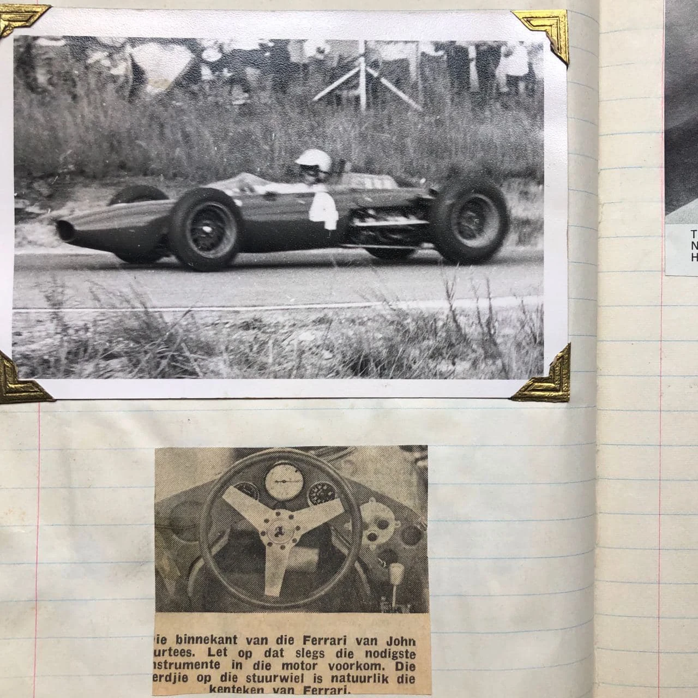
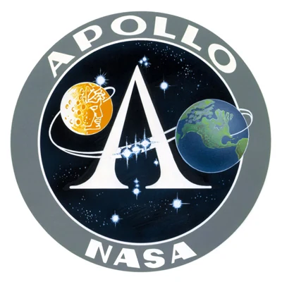
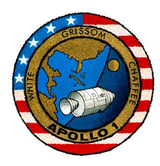
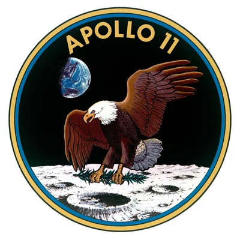

My brother was a teenager in the sixties. He kept scrapbooks -- the 60s analogue version of Instagram and Facebook. The books were filled with profile pics and signatures of race car drivers, a collage of science and fiction, the stuff that inspired boys of his generation to become astronauts and race car drivers and conversely inspired tomboy sisters of my generation to dream and do and follow in their footsteps. I sleuthed through his treasures; newspaper clippings, popular science magazines, sketches of cars and foldouts of rockets and engines, his 7-inch 45rpm vinyl record collection. Roy Orbison sang about a _Pretty Women_, The Beach Boys called her _Barbara Ann_ and The Troggs made “everything groovy”.

Scrapbooks of Cars

Newspaper clippings

Scrapbooks of Cars

One day, I found a fold-out in one of his magazines of the Apollo Program and entranced by the Project Apollo insignia, the Moon indeed hinted that I could explore beyond. Urged on by The Troggs begging, _“Come on, come on wild thing”_, I took a pair of scissors and defiled the collectable, crudely cutting around the edges of the insignia. There were things to discover, more magical even than an older brother’s scrapbook collection and he wasn’t around to stop me!

Apollo Program Insignia

I stapled the crudely cut Insignia to my jacket, put my brother’s crash helmet on and moon-walked across the green lawn.

> _Catch a falling star and put it in your pocket, never let it fade away._

My brother’s scrapbook entries abruptly stopped -- around the same time three brave men lost their lives in what was supposed to be the first manned Apollo Flight. Gus Grissom, Ed White and Roger Chaffee were conducting a simulation on the launch pad in Florida, when a flash fire broke out in their capsule. (Jan 1967).

In March of 1967, NASA announced that the mission originally scheduled for Grissom, White and Chaffee would be known as Apollo 1. and the first Saturn V launch, scheduled for November 1967, would be known as Apollo 4. No missions or flights were ever designated Apollo 2 or 3.

Remembering Apollo 1

My brother wasn’t around to keep newspaper clippings, or foldouts, as he was tragically killed in a motorcycle accident on 25 March 1967.

By the time I arrived on Earth, two years had passed since Apollo 11 and Neil Armstrong left footprints on the Moon.

Apollo 11

I still have my brother’s scrapbooks and he inspires me every day.

> _Wild thing  
> You make my heart sing  
> You make everything groovy_
>
> \- _The Troggs 1965_

Read more about the Apollo missions here:

[Remembering Apollo 1](https://www.nasa.gov/mission_pages/apollo/apollo-1)

[Apollo Mission Patches](https://solarsystem.nasa.gov/resources/2293/apollo-mission-patches/ "Apollo Mission Patches")
