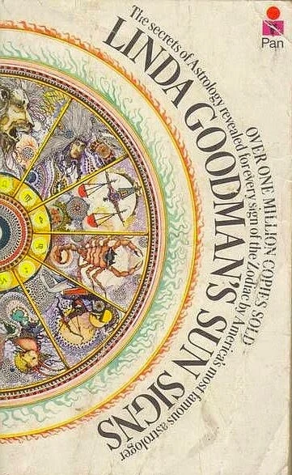
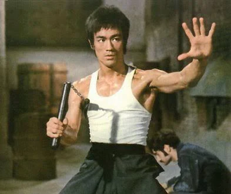
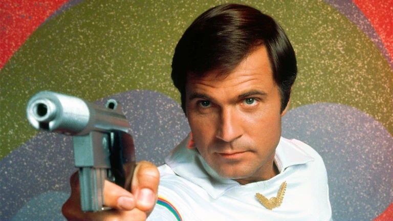
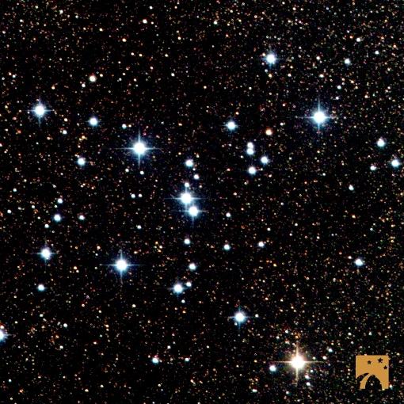

Like any well respected middle-class family in the 70s, we had _Linda Goodman’s Sun Signs_ on our bookshelf. I loved the Pan Macmillan dust cover. Neither my parents nor siblings held firm believes over star signs and the supposed influence on personality and life-paths. The book made it to our shelf, testament to Mom who followed the book columns in the local press and for that matter her heart, because we had Colleen McCullough’s Thornbirds in our collection too! And it was only a matter of, well _"time"_ before Hawking’s “A Brief History…” joined Carl Sagan’s _Cosmos_. Judging by the books in our modest, yet eclectic family library, we were well on our way to interpret and comment on a polarized world about to tear itself apart in the 21st century.

Linda Goodman's Sun Signs

Linda Goodman’s Sun Signs became a placeholder for me to map new friends and family to. “It is aunt Marie’s birthday tomorrow”, mom would exclaim, and I would more often than I’d like to admit plot their birth-date to where they fit in the cosmos according to Linda Goodman.

Until 1978 I did not know any people born under the Scorpio Sun Sign. But then things changed, my sister started dating a scrawny “Scorpion”, born on November 13. I instantly claimed my sister’s new boyfriend as my best friend. He knew everything about Lego, electronics and things called computers and Space! We watched Buck Rogers together and he was so much fun to be around. He taught me chess, we play-wrestled, he made me do push-ups until my arms and shoulders hurt and showed me his ninja stars and "nunchaks", but I secretly thought he was way cooler than Bruce Lee.

I was 7 and he was 18 when he started dating my sister and I was 10 or 11 when he became my brother-in-law. Even then it was clear -- he held a firm belief that any girl could achieve what boys can. He sold me science and literally instructed my dad to buy me my first computer. Thank You. I was headstrong and I remember how I refused to listen to my parents and sisters when I was instructed to remove spider-webs of mascara, lipstick and lip-gloss from my face. But when _he_ said that I was beautiful enough and did not need all the makeup at 10. I listened. As a matter of fact he was so convincing that I decided to ditch the idea of wearing makeup for good.

No make-up needed Izzi, that's for Wilma Deering

We grew a little apart as years flowed on, no doubt caught in vortices of work and culture and surviving in a polarized world that pins us at opposing ends – my brother-in-law: the so-called privileged white male, and on the flip-side, there’s me, female-gender-queer and deeply and disturbingly for most _unclassifiable_. 

M7 Diamonds in the tail of Scorpio

But, just as I cannot be bothered to believe the drivel astrologers claim to assign to people born under some star sign. Or the unverified claims held of people who are not the same as us, I am headstrong and unapologetic and will not allow myself to be discriminated against and will fight with equal fervor those who discriminate against me and those who seek to vilify men like my brother in law, I am eternally grateful for him. The sting in his tail, is filled with diamonds and wonder and he is precious to me. Happy 60th journey around our Star, Pieter. Thank You, for everything.
