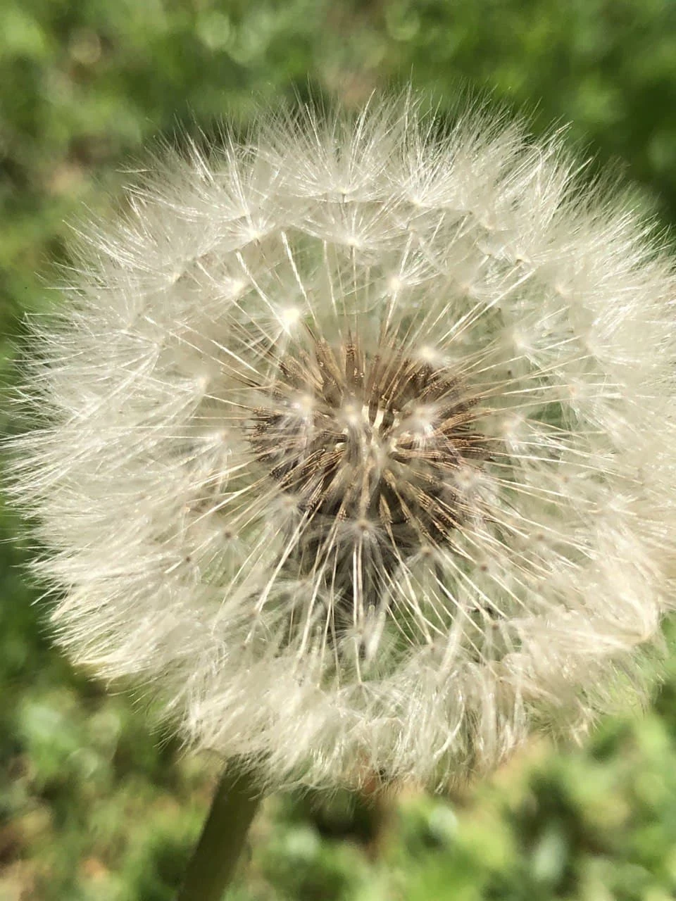
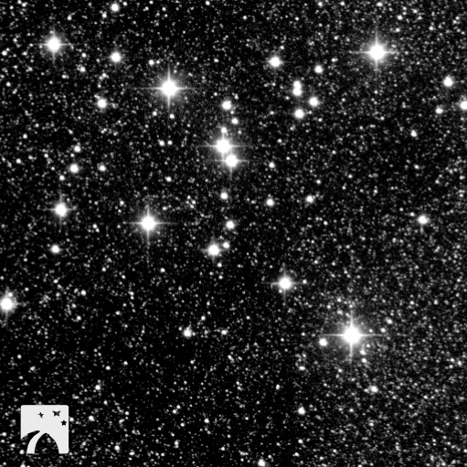
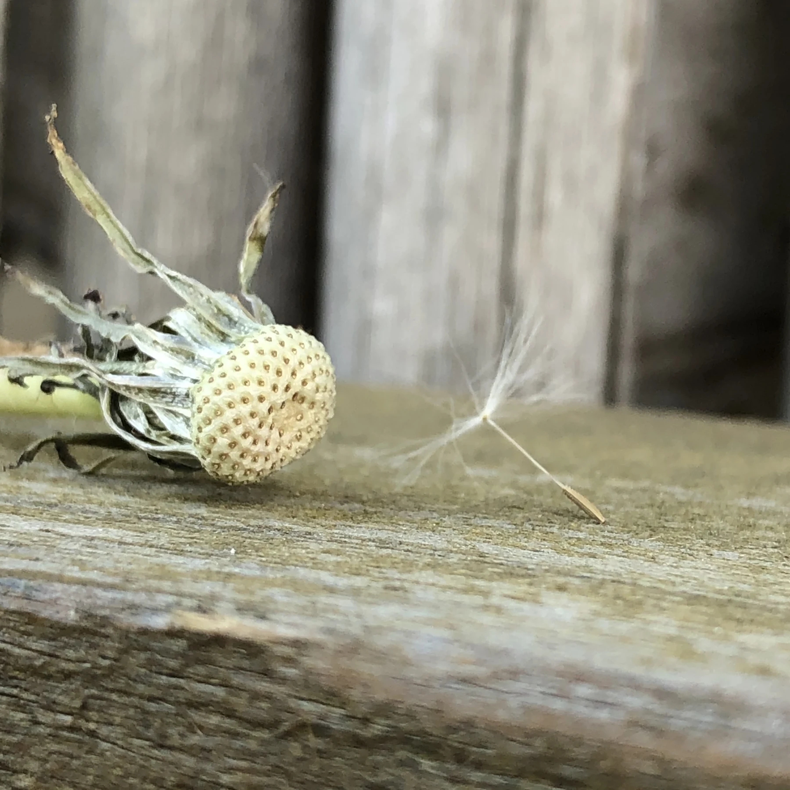

Today I observed a dandelion, stalked by the midday sun, its star-cluster head intact and deceptively simple, because astonishingly each of the seeds in the crowned head, can have a different genetic makeup. I playfully map imaginary constellations, tracing starry pin-pricks of seed points. A geocentric simplicity in a contained Ptolemaic cosmos -- home to hundreds of individual flowers.

Cluster of seeds of the Dandelion

A 1000 light years from the dandelion in my garden hangs an arrangement of about 80 or 100 stars in an open cluster. It is believed to be about 220 million years old and observed, catalogued and described by Claudius Ptolemy in the 2nd century as Object Number 567 in his Almagest – the “nebula following the sting of Scorpius”. In 1764 Charles Messier catalogued this cluster as M7, and it’s with this catalogue in hand that I map my nightly missions across space with Slooh.

Because the stars in M7 were all born at roughly the same time, they have the same chemical composition and are as precious as the diamonds they resemble to scientists studying stellar evolution and structure. With wonder I ponder and exaggerate the sameness of stars in a cluster 25 light-years in diameter and the diversity in the dome of a dandelion seed-head.

As the stars in the M7 Cluster age, the brightest of those diamonds in the tail of Scorpio will violently explode as supernovae. Eventually the remaining faint stars will slowly drift apart, they will barely be recognizable as a cluster.

Dandelion gone nova

You can read more about the fascinating world of dandelions here:

> _Each unit of a dandelion is actually home to hundreds of individual flowers clustered together. Because dandelions can reproduce both sexually (through pollination) and asexually, every seed emerging from a dandelion’s head can have a different genetic makeup._

[https://www.pbs.org/wgbh/nova/article/dandelion-seed-flight/](https://www.pbs.org/wgbh/nova/article/dandelion-seed-flight/ "https://www.pbs.org/wgbh/nova/article/dandelion-seed-flight/")

[https://qz.com/1428565/physicists-discover-new-form-of-flight-thanks-to-dandelion-seeds/](https://qz.com/1428565/physicists-discover-new-form-of-flight-thanks-to-dandelion-seeds/ "Flights of fancy")

If you want to take pictures of stars and planets, visit [slooh.com](https://www.slooh.com/NewDashboard "slooh.com")

Slooh is where amateur and professional astronomers alike, help, play and learn about the wonders of the cosmos.
