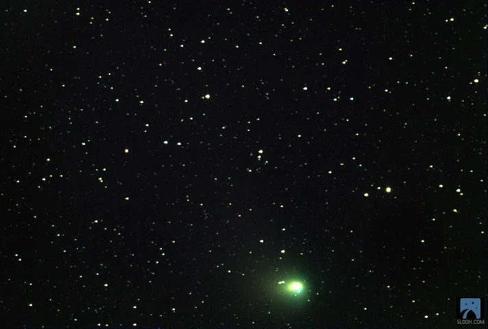
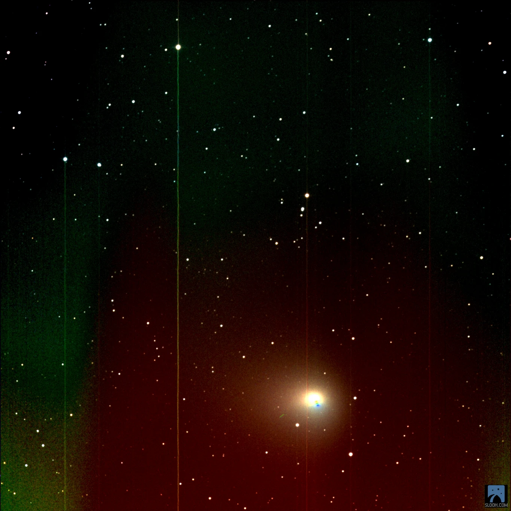
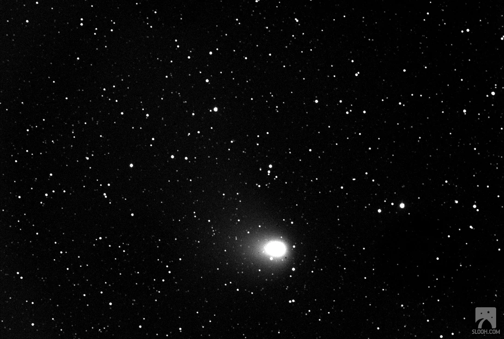
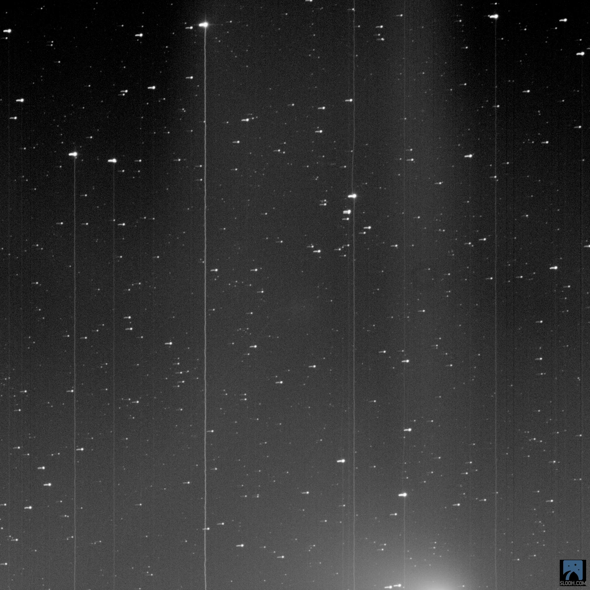
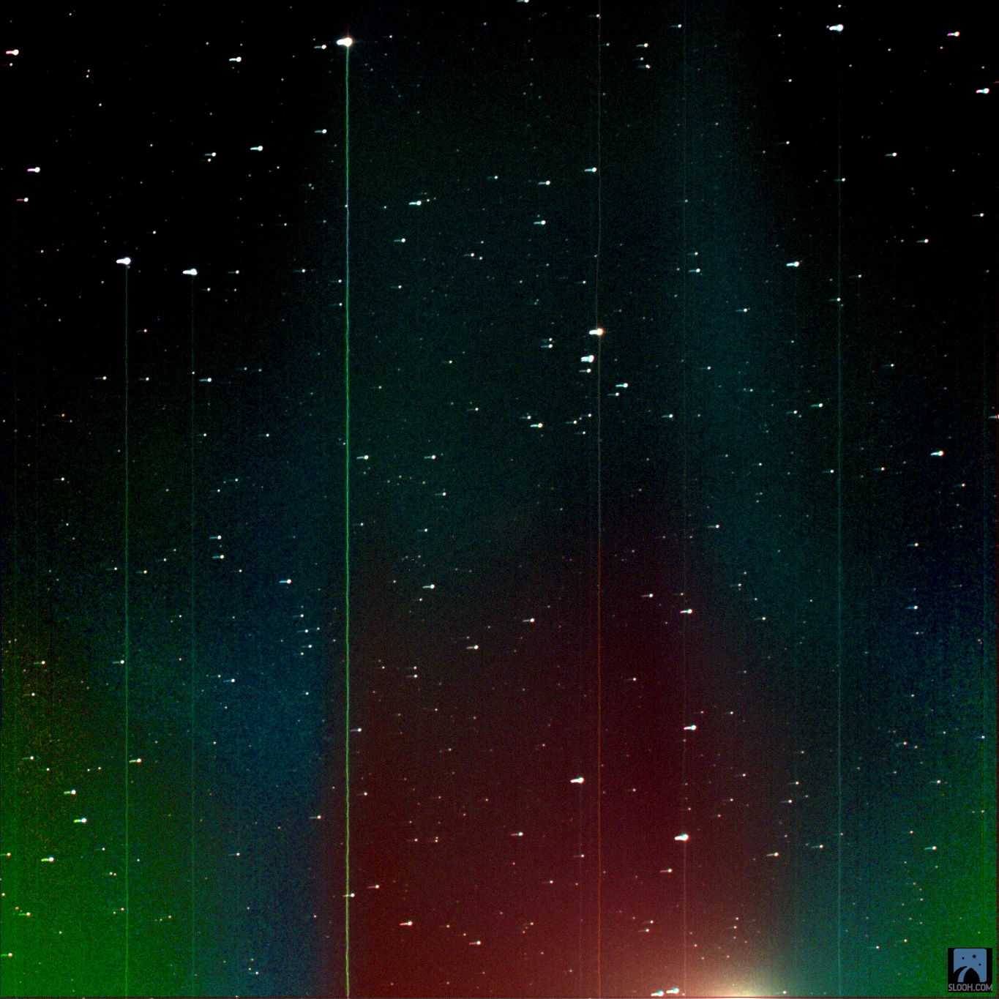
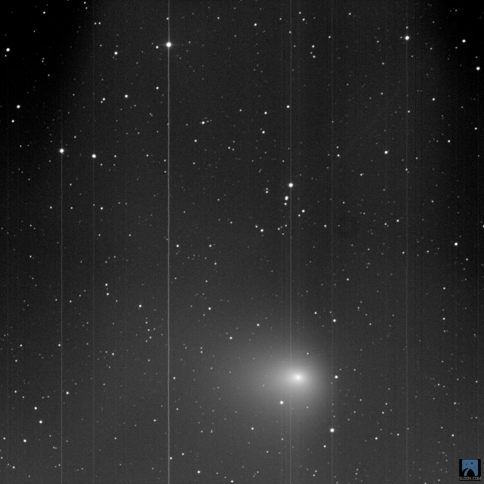
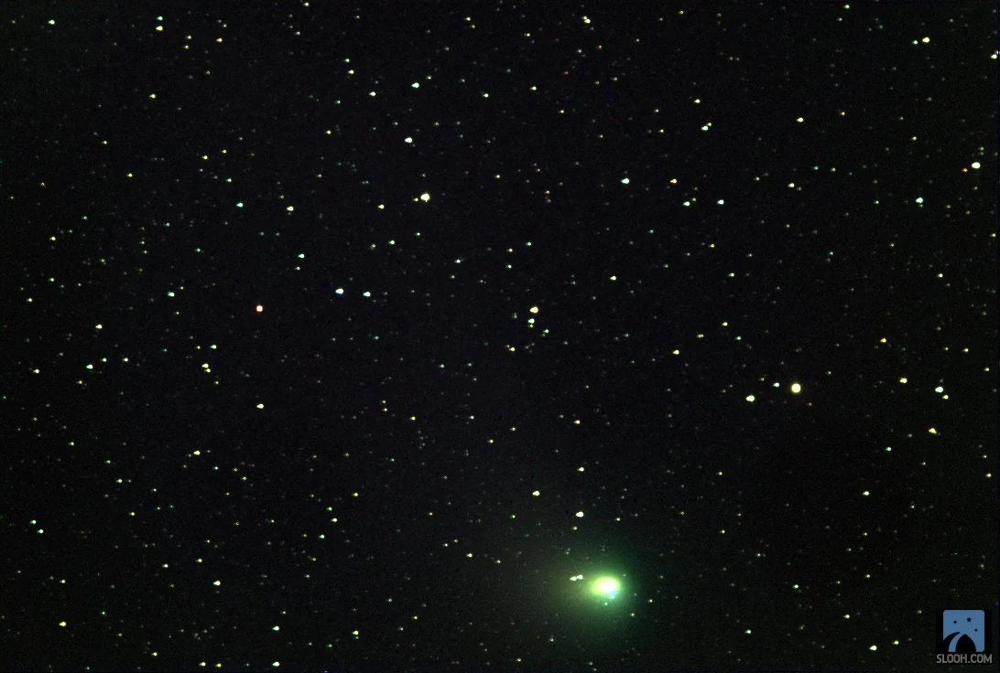

For Clint.
  
In his "Thoughts on Various Subjects" from 1706, Jonathan Swift wrote:

> "Old men and comets have been reverenced for the same reason: their long beards and pretences to foretell events".  

Green Comet

Slooh art streaks

ZTF

  
Let's face it. the true fortune tellers are the scientists who can predict when a cataclysm, stability or highpoint, could be expected. We have data scientists, and powerful algorithms and machine learning. These are rocket ships for our minds, as opposed to our classic computers, who Steve Jobs compared to [Bicycles of the Mind](https://www.themarginalian.org/2011/12/21/steve-jobs-bicycle-for-the-mind-1990/).  
  
In March 2022, Comet 2022 E3 (ZTF) was discovered by astronomers using the wide-field survey camera at the Zwicky Transient Facility. It has brightened substantially and the images in this gallery were captured with the Slooh Telescopes.
  
The hiatus from my hobby of star gazing, coincided with recent events, that if we paid careful attention to the data at our disposal we could predict.
  
You see, I work in IT, and there is blood in the virtual streets as Google, Amazon, Spotify, Microsoft and a myriad in the Crypto space cut people from the workforce. My own company announced a 35% reduction in work force.
  
I was reminded by a colleague whose role has been made redundant "to always look up", when in a moment of gloom and cynicism I remarked "I have not had time for my star gazing hobby . . . "
  
I now choose to look up, not expecting a bright future, but facing the beauty and the horror. It will always be meted in equal measure, it is never as simple as foretelling of great things, or disasters. It is up to us how we choose to respond to our interpretation of signs, and comets.

## Links

- More about [Green Comet C/2022 E3 (ZTF)](https://www.space.com/comet-c2022-e3-ztf-closest-approach-feb-1) on Space.com.
- More about [Jonathan Swift](https://en.wikipedia.org/wiki/Jonathan_Swift) on Wikipedia.
