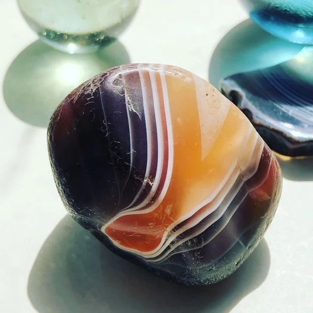
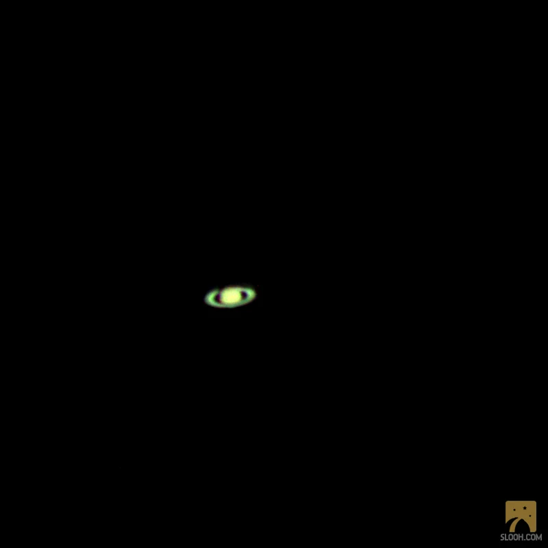

The rings of agate

I wish I were a tree, so I would count my years as rings hidden from the outside by bark and moss. The only clue to how much I have accumulated would be in the thickness of my trunk and my long-limbed branches outstretched to the stars and moon above.

As a tree, I would not have to name things or write them down to remember. Everything would be perfectly stored in growth rings, I would be one with what I have become and have the perfect memories to prove it. Eventually I suppose, once felled or fallen, I may divulge all memories of environment and climate, else it would stay hidden and uncorrupted.

I am not a tree, I look up at the heavens, I plot the journey of stars, I observe the moons of Saturn, commit their names to memory and trace the link between Phoebe and the corresponding orbiting ring. I make lists in notebooks, I learn and study and leave traces of what I experience outside of myself. I learn from traces other humans leave, thus I marvel as I review how we have categorized the rings of Saturn and in equal splendor named them.

I am not a tree, I don’t form geometric memories; my memories are imperfect. They tilt and twist and turn and fall apart under the heaviness of emotion. Alas we don’t count our years like trees. Perhaps we count our years in what we experience, what we see, hear, taste smell and interact with. Layer upon layer of story and interaction, those memories follow us, they are bound to us. Exposed, like the rings of Saturn, not those of trees.

Saturn observed with Slooh on 4 November 2020

