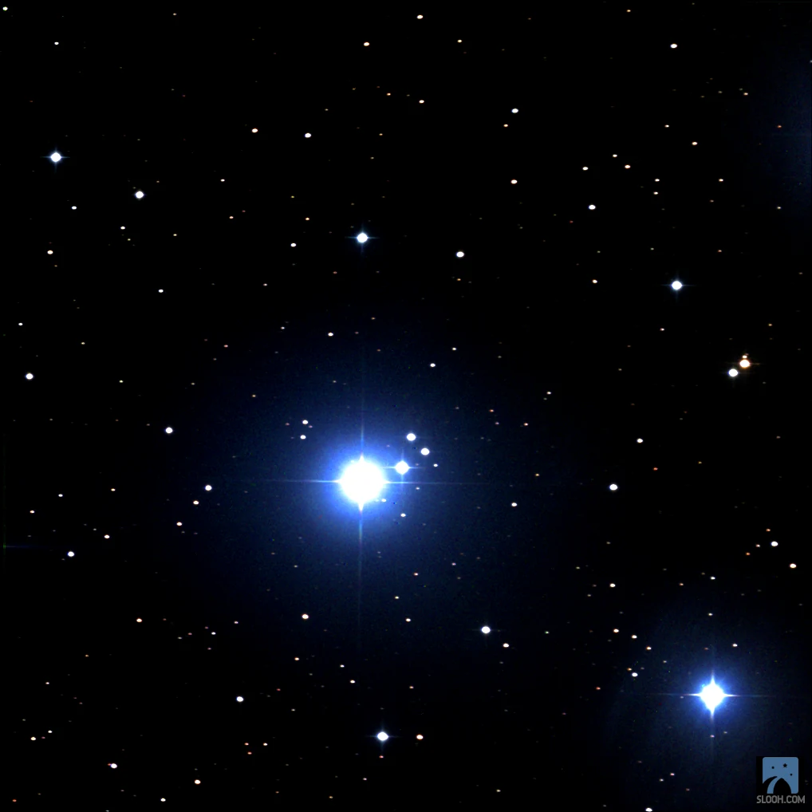
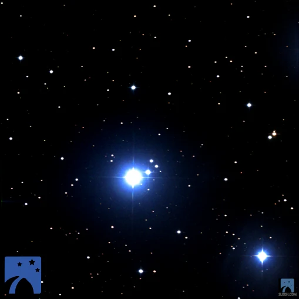

_When the Pleiades fall, I wake looking for my goatskin bag to drink. When (the Pleiades) rise, I wake looking for cloth/clothes to wear. -_ A Tuareg Berber proverb

When I was a little girl, my favourite stars were the three clear ones -- the belt of Orion. They were the three sisters, up far in the sky. They reminded me of my own three sisters who were older, sometimes distant and not always interested in their tomboy-baby sister. Summer evenings in the Southern Hemisphere, the sounds of crickets and frogs on a warm summer evening. My mom and dad and I would sit on the porch, staring up at the heavens. All the lights, inside and outside would be switched off. We’d hear the neighbor’s television,  somewhere the theme song of Dallas, Dynasty or the A-Team jingled over and across to us and then up and out toward the stars.  An analog broadcast propagating through space, catching a ride with Miss Elly and Larry Hagman. Where are they now?

In 2020 we have our own true villains. JR Ewing meet Donald J. Trump. This too shall pass.

The Three Sisters, as I referred to the Belt of Orion is still up there. And the Pleiades, the Seven Sisters who I could never quite place. Sometimes I struggled to find all seven and they grew ever fainter as the lights grew brighter in the cities.

Tonight I pointed the Canary One - Half Meter telescope to the Sisters. Conditions were not ideal. It was blurry, there were clouds and dust and moonlight. Yet there they were, (pictured in the header image) — the closest sisters shining friendly. I’ve not seen them this close before. It’s now or never. In another 250 million years from now, the Pleiades will disperse due to gravitational interactions with its galactic neighborhood.

Our lives are complex, and short. The stars live simply, and for a little longer.

Pleiades M45 - Canary One - Half Meter telescope

