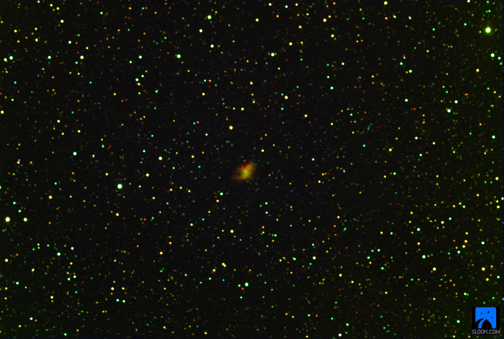
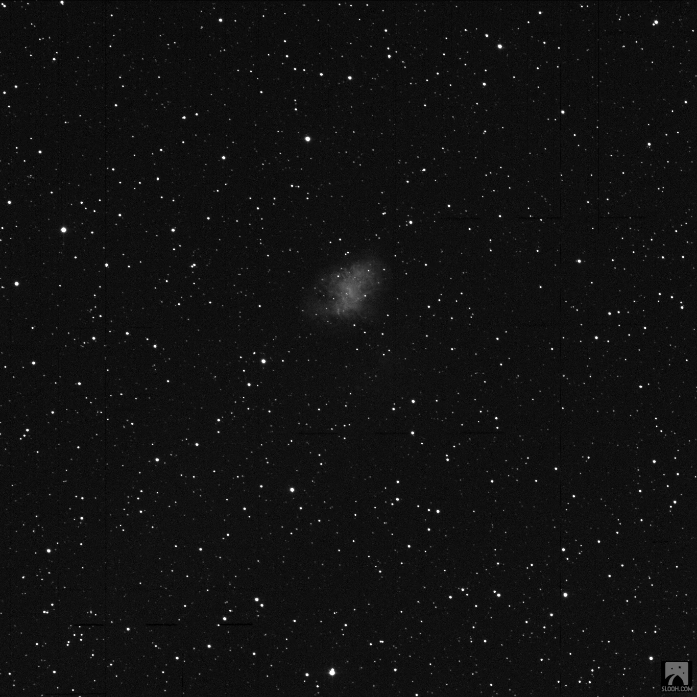
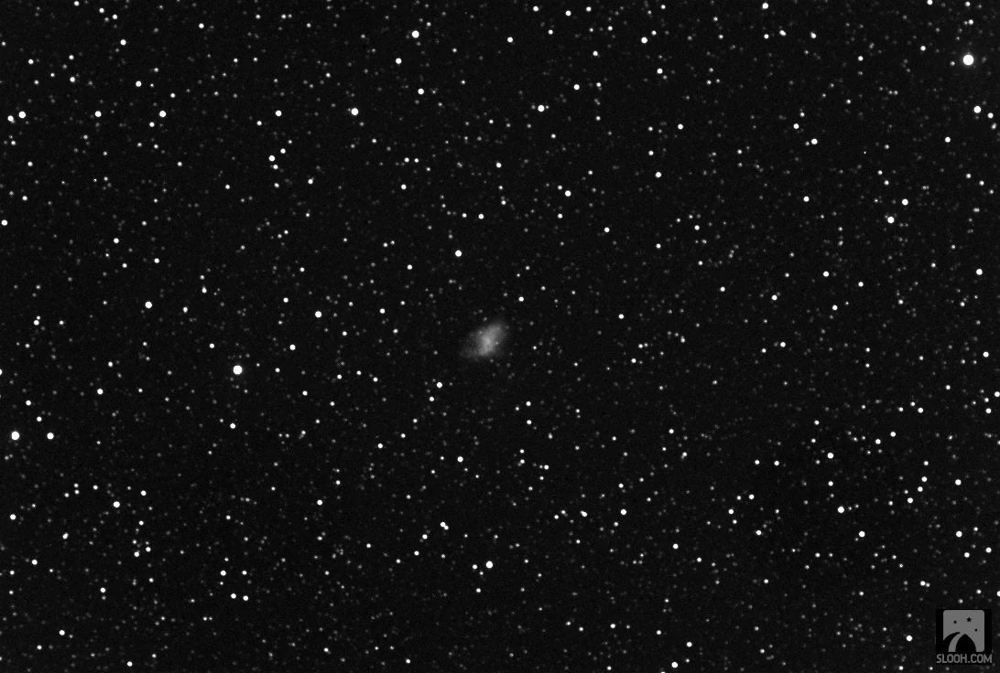

This is the Crab Nebula Messier Object 1, it is not the best image out there, but bear with me, it was my first mission to visit this M1 and I am happy to add it to my SLOOH gallery. While you look at the Crab Nebula, travel back in time with me, only a thousand years or so. We set our time traveling machine’s dial to 1054, and we are going to the Sung dynasty in China.

Crab Nebula M1

Crab Nebula M1

Crab Nebula M1

When we arrive some time in July of 1054, we see Yan Wei-te, (the Director of Astronomy) prostrated before the Chinese Emperor. He is tasked with the unfortunate burden to report the appearance of a “guest star” out of nowhere – this failure to have predicted the event could lead to public prosecution. The life of an astronomer in the Middle Ages was stressful.

It is possible to pick up the disposition he was in from the style of his observation. It is written with clarity and sensitivity expected from a scientist, while he navigates and manages the political landscape and risk, as best he can.

> _I humbly observe that a guest star has appeared; above the star there is a feeble yellow glimmer. If one examines the divination regarding the Emperor, the interpretation \[of the presence of this guest star\] is the following: The fact that the star has not overrun Bi (a Chinese Constellation) and that its brightness must represent a person of great value. I demand that the Office of Historiography is informed of this."_
>
> _All officials congratulated the Emperor, who ordered his congratulations be \[back\] forwarded to the Office of Historiography. First year of the era of Jiayou, third lunar month, the director of the Astronomical Office said_
>
> _"The guest star has disappeared, which means the departure of the host \[that it represents\]." Previously, during the first year of the Zhihe era, during the fifth lunar month, it had appeared at dawn, in the direction of the east, under the watch of Tiãnguãn (Zeta Tauri). It had been seen in daylight, like Venus. It had rays stemming in all directions, and its colour was reddish white. Altogether visible for 23 days._

I’ll refrain from commenting on the arrival or departure of “a person of great value”, in the context of the American Election which is taking place today, 3 November 2020. However, I want to mention that I find inspiration in Yan Wei-te's precise observation which shines through and outlived the political correctness in tone. At its core his observation provided scientists with enough evidence to increase the plausibility that was eventually confirmed in 1942 beyond reasonable doubt that the Crab Nebula could be identified as the supernova remnant of this event the astronomer observed and “humbly” reported on.

Women and men that deem themselves of great importance come and go, it is however strangely comforting to know that the clarity of scientific truth is classic and outlasts the whims of political ideology.

If you want to learn how to capture images and observations like this one, visit [slooh.com](https://www.slooh.com/ "slooh.com"). On Slooh, professional and amateur astronomers work and play together to make Astronomy accessible to everyone on planet Earth.
