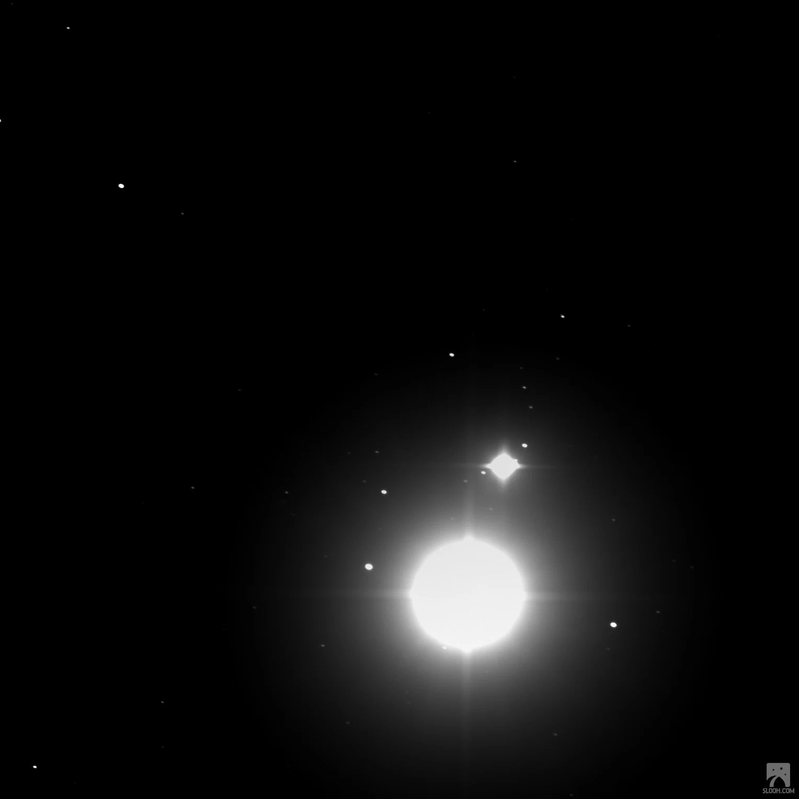
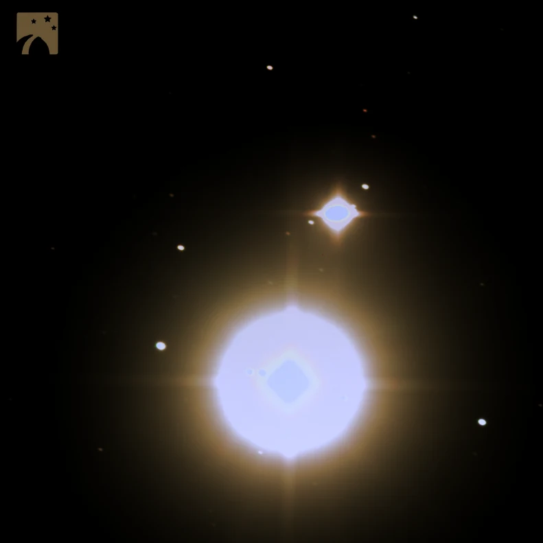

Sometimes we look up at the skies because someone told us to, or we read about it in the news and we don’t want to miss a once in a lifetime event.

_“If you don’t look now, you’re never going to see this again. Ever.”_

_“Not again in your lifetime.”_

_“The last time this happened was in 1623!”_

While it provides the spark to ignite a lifelong love for the stars and skies, I also find it a little absurd. This fear of missing out on a galactic scale. I first experienced it in 1986 when my mom woke me early one morning to behold a feint smudge of something she said, was Hailey’s comet. Today, it is not the comet I remember, I remember the moment with my mom, and I remember her. I cherish the memory of that moment because I know each moment is unique. Every interaction with a person, plant or animal is unique in that moment. A singular conjunction of conscious observation.

You see, we are able to make accurate predictions where it concerns which bodies in the heavens will be in conjunction with which. There is a frenzy of interest and activity as everyone is keen to observe the "closeness" of Saturn and Jupiter brushing past each other, cheeks touching, while the rest of the universe is hurtling past, flurrying further apart. We do not know if the person on the street, in the shop, the neighbour, the sister or brother that we assume will be there, will in fact be there next year. We are somewhat intelligent but we are so vulnerable. We do not know how long we have, who does? We cannot predict when we will be as close as we are today. For all we know today will be the closest we will ever be.

Let’s wake up to knowing that every conscious moment on earth is a once in a lifetime event. Because, this moment, this very moment in which you read this sentence, pause and stop. This will never happen again, you will not experience this again. Every moment is your conjunction to behold and to cherish the bonds you have with other life on this planet.

Let’s cherish the present, because this moment is all we will ever have.

The next Great Conjunction between the two planets – although not nearly as close together – is due in November 2040. An alignment similar to the one observed on 21 December in the images posted here will take place again in March 2080. 

[www.slooh.com](http://www.slooh.com)

We can be close while we practice social distancing, perhaps like Jupiter and Saturn.
